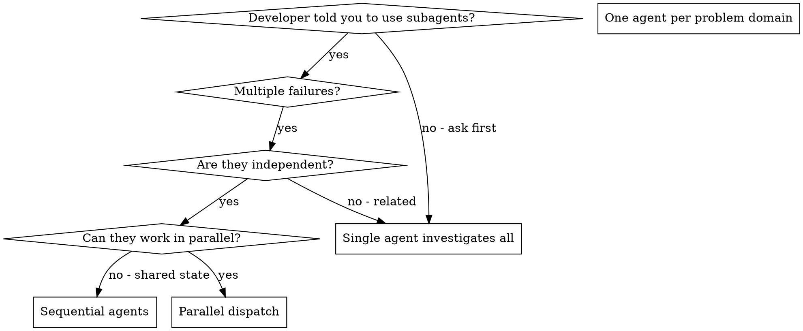

# Dispatching Parallel Agents

## Overview

You delegate tasks to specialized agents with isolated context. By precisely
crafting their instructions and context, you ensure they stay focused and
succeed at their task. They should never inherit your session's context or
history — you construct exactly what they need. This also preserves your own
context for coordination work.

When you have multiple unrelated failures (different test files, different
subsystems, different bugs), investigating them sequentially wastes time. Each
investigation is independent and can happen in parallel.

**Core principle:** Dispatch one agent per independent problem domain. Let them
work concurrently.

> **Local modification.** This skill is imported from
> [obra/superpowers](https://github.com/obra/superpowers/tree/main/skills/dispatching-parallel-agents)
> and edited to (1) require explicit developer opt-in before any dispatch,
> (2) mandate cheap models for subagents, and (3) specify a per-harness polling
> cadence. The upstream dispatch guidance below is unchanged.

## Developer Opt-In Required

<HARD-GATE>
Do NOT dispatch, spawn, or delegate to subagents unless the developer
explicitly authorizes it in the current task.

Authorization must be a direct instruction in the developer's own words, for
example: "use subagents", "dispatch these in parallel", "spawn an agent per
test file", or "delegate this".

These do NOT count as authorization:

- You deciding the task "looks parallelizable".
- The task being large or having many independent files.
- A general standing preference ("I like parallel work") with no instruction
  for the current task.
- Authorization given in a previous task that has since ended.

If parallel dispatch would clearly help but you have not been told to use it,
ask once:

> "This looks like N independent problems. Want me to dispatch one subagent per
> problem in parallel? If not, I'll work through them sequentially."

Then wait for the answer. Absent an explicit yes, do the work yourself, in this
session, sequentially. Dispatching without opt-in is a failure, not initiative.
</HARD-GATE>

## Model Selection

Subagents run cheap models. You (the coordinating session) run the expensive
reasoning model; the delegated work is well-scoped execution, so pay for
coordination, not for helpers.

Assign subagents one of these cheap/fast models:

| Cheap model           | Notes                                              |
| --------------------- | -------------------------------------------------- |
| ChatGPT Luna          | Fast general-purpose executor.                     |
| DeepSeek v4.1 Flash   | Very low cost; good for mechanical/scripted edits. |
| Claude Sonnet         | Cheap tier when a subagent needs stronger reasoning. |
| Muse-Spark            | Cheap tier for lightweight/creative subtasks.      |

Rules:

- **Pick the cheapest model that can do the job.** Escalate to a smarter cheap
  model only if the subtask genuinely needs it; never silently use a premium
  model for a subagent.
- Use whatever the harness's actual model selector calls these; if a named
  model is unavailable in the current harness, choose the cheapest available
  equivalent and say which one you used.
- Never run a subagent on the same top-tier model as the coordinator unless the
  developer explicitly asks for it.
- State the chosen model in each subagent's dispatch and in your final summary.

## Harness Polling Cadence

After dispatching background subagents, check on them by polling. Polling too
often re-prefills the shared prompt cache and destroys cache retention, so use
the cadence for the harness you are running in.

| Harness                                   | Poll cadence            |
| ----------------------------------------- | ----------------------- |
| Claude Code                               | Every **4 minutes** (manual) for cache retention. |
| Codex                                     | Every **25 minutes** (manual). |
| opencode running OpenAI models            | Every **25 minutes** (manual). |
| Any other harness                         | Wait for completion; do not poll faster than 25 minutes unless the developer says otherwise. |

Rules:

- **Manual polling only** — you schedule the next check yourself; do not set up
  an aggressive auto-poll loop.
- On Codex and opencode-with-OpenAI-models: **wait for completion** between
  checks. Do not poll faster than every 25 minutes.
- If a subagent finishes before the interval elapses, use the result
  immediately — the interval is a floor for how often you ask, not a delay you
  must serve out.
- If the developer overrides the cadence for the session, follow their number.

## When to Use



**Use when:**
- The developer explicitly authorized subagents, AND
- 3+ test files failing with different root causes
- Multiple subsystems broken independently
- Each problem can be understood without context from others
- No shared state between investigations

**Don't use when:**
- The developer did not authorize subagents (ask, or do it yourself)
- Failures are related (fix one might fix others)
- Need to understand full system state
- Agents would interfere with each other

## The Pattern

### 1. Confirm Opt-In and Identify Independent Domains

Confirm the developer authorized subagents. Then group failures by what's broken:
- File A tests: Tool approval flow
- File B tests: Batch completion behavior
- File C tests: Abort functionality

Each domain is independent - fixing tool approval doesn't affect abort tests.

### 2. Create Focused Agent Tasks

Each agent gets:
- **Specific scope:** One test file or subsystem
- **Clear goal:** Make these tests pass
- **Constraints:** Don't change other code
- **Cheap model:** One from the Model Selection table
- **Expected output:** Summary of what you found and fixed

### 3. Dispatch in Parallel

Issue all three subagent dispatches in the same response — they run in parallel,
each on its assigned cheap model:

```text
Subagent (cheap model): "Fix agent-tool-abort.test.ts failures"
Subagent (cheap model): "Fix batch-completion-behavior.test.ts failures"
Subagent (cheap model): "Fix tool-approval-race-conditions.test.ts failures"
# All three run concurrently.
```

Multiple dispatch calls in one response = parallel execution. One per response = sequential.

### 4. Poll at the Harness Cadence

Check on the dispatched agents using the cadence in **Harness Polling Cadence**
(Claude Code: every 4 minutes; Codex / opencode OpenAI: every 25 minutes, else
wait for completion). Do not poll faster.

### 5. Review and Integrate

When agents return:
- Read each summary
- Verify fixes don't conflict
- Run full test suite
- Integrate all changes

## Agent Prompt Structure

Good agent prompts are:
1. **Focused** - One clear problem domain
2. **Self-contained** - All context needed to understand the problem
3. **Specific about output** - What should the agent return?
4. **Model-assigned** - State which cheap model the subagent must run

```markdown
Model: DeepSeek v4.1 Flash (cheap tier)

Fix the 3 failing tests in src/agents/agent-tool-abort.test.ts:

1. "should abort tool with partial output capture" - expects 'interrupted at' in message
2. "should handle mixed completed and aborted tools" - fast tool aborted instead of completed
3. "should properly track pendingToolCount" - expects 3 results but gets 0

These are timing/race condition issues. Your task:

1. Read the test file and understand what each test verifies
2. Identify root cause - timing issues or actual bugs?
3. Fix by:
   - Replacing arbitrary timeouts with event-based waiting
   - Fixing bugs in abort implementation if found
   - Adjusting test expectations if testing changed behavior

Do NOT just increase timeouts - find the real issue.

Return: Summary of what you found and what you fixed.
```

## Common Mistakes

**❌ Self-authorizing dispatch:** "This is obviously parallel, I'll spawn agents"
**✅ Opt-in first:** Wait for the developer's explicit instruction, or ask.

**❌ Premium models for subagents:** Running every helper on the top-tier model
**✅ Cheap models:** ChatGPT Luna / DeepSeek v4.1 Flash / Claude Sonnet / Muse-Spark

**❌ Polling in a tight loop:** Re-prefilling context and wrecking cache
**✅ Harness cadence:** Claude Code every 4 min; Codex / opencode OpenAI every 25 min

**❌ Too broad:** "Fix all the tests" - agent gets lost
**✅ Specific:** "Fix agent-tool-abort.test.ts" - focused scope

**❌ No context:** "Fix the race condition" - agent doesn't know where
**✅ Context:** Paste the error messages and test names

**❌ No constraints:** Agent might refactor everything
**✅ Constraints:** "Do NOT change production code" or "Fix tests only"

**❌ Vague output:** "Fix it" - you don't know what changed
**✅ Specific:** "Return summary of root cause and changes"

## When NOT to Use

**No opt-in:** The developer didn't ask for subagents - ask first or do it yourself
**Related failures:** Fixing one might fix others - investigate together first
**Need full context:** Understanding requires seeing entire system
**Exploratory debugging:** You don't know what's broken yet
**Shared state:** Agents would interfere (editing same files, using same resources)

## Real Example from Session

**Scenario:** 6 test failures across 3 files after major refactoring (developer
explicitly said "dispatch a subagent per failing test file").

**Failures:**
- agent-tool-abort.test.ts: 3 failures (timing issues)
- batch-completion-behavior.test.ts: 2 failures (tools not executing)
- tool-approval-race-conditions.test.ts: 1 failure (execution count = 0)

**Decision:** Independent domains - abort logic separate from batch completion separate from race conditions

**Dispatch (cheap models):**
```
Agent 1 (DeepSeek v4.1 Flash) → Fix agent-tool-abort.test.ts
Agent 2 (ChatGPT Luna)        → Fix batch-completion-behavior.test.ts
Agent 3 (Claude Sonnet)       → Fix tool-approval-race-conditions.test.ts
```

**Polling:** Claude Code session → checked every 4 minutes until all three returned.

**Results:**
- Agent 1: Replaced timeouts with event-based waiting
- Agent 2: Fixed event structure bug (threadId in wrong place)
- Agent 3: Added wait for async tool execution to complete

**Integration:** All fixes independent, no conflicts, full suite green

## Verification

After agents return:
1. **Review each summary** - Understand what changed
2. **Check for conflicts** - Did agents edit same code?
3. **Run full suite** - Verify all fixes work together
4. **Spot check** - Agents can make systematic errors
5. **Confirm models** - Verify subagents actually ran on the cheap tier assigned
